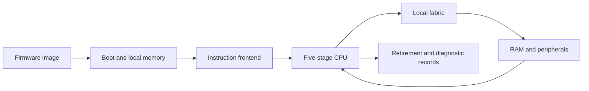
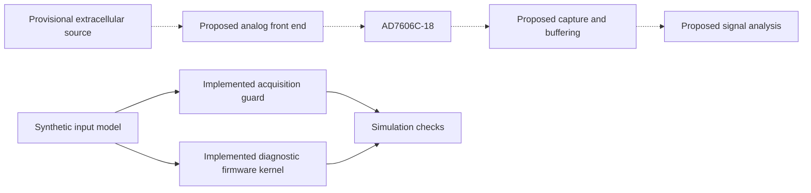

# DRG pain project

This project develops a programmable RISC-V microcontroller for acquiring and processing dorsal root ganglion signals. The goal is an embedded recording platform that preserves sample timing, reports data loss, and supports reproducible signal analysis. Extracellular recordings from cultured neurons provide the provisional source model. The electrode connection, analog circuit, and complete acquisition board remain unresolved; biological recording protocols, biomarker validation, and therapeutic modulation are later work.

The current implementation contains a custom five-stage CPU, local memories and peripherals, firmware, boot and debug logic, and simulation and synthesis tooling. The proposed input chain uses an INA819 amplifier, an OPA2140 filter stage, and the AD7606C-18 on the EVAL-AD7606C18FMCZ board. That component selection does not establish a working neural recording interface. The [microcontroller guide](microcontroller/README.md) distinguishes implemented logic from acquisition, memory, and signal-processing proposals.

## Setup and usage

### Obtain the source

Install Git and clone the repository. Run the commands below from its root unless a component guide states otherwise. Several build helpers require POSIX tools and paths without whitespace, so use a checkout and output location that meet those constraints.

```sh
git clone https://github.com/baolgn/DRG-pain-project.git
cd DRG-pain-project
```

### Select the host environment

Development uses free and open-source tools. Existing simulation and mapping captures come from a Linux development environment; they do not establish Windows or macOS compatibility. Tool support for an operating system also does not qualify every project runner on that system.

| Host | Setup and usage | Verification boundary |
| --- | --- | --- |
| Ubuntu Linux | Install Python 3, Git, GNU Make, a C++ compiler, ripgrep, and the tools required by the selected component guide. Run the shell commands from the checkout root. | Retained captures document particular tool builds and inputs. Other package versions require a fresh run. |
| Windows | Git can obtain the source from PowerShell. Use an Ubuntu Linux environment for the documented simulation commands because several runners require POSIX process groups, shell tools, and Linux executable layouts. | Native Windows execution and hardware access through a virtualized environment remain unverified. |
| macOS | Git can obtain the source from Terminal. An Ubuntu environment provides the closest command layout. Native builds require host-compatible tools and changes to fixed Linux tool paths where a runner has no override. | Intel and Apple silicon workflows remain unverified. Linux x86-64 binaries cannot run directly as native macOS programs. |

[Verilator](https://verilator.org/guide/latest/install.html) compiles RTL simulations. [OSS CAD Suite](https://github.com/YosysHQ/oss-cad-suite-build) distributes open-source FPGA and verification tools, including Yosys and nextpnr; its installation instructions describe host-specific activation. Firmware requires a bare-metal [RISC-V GNU toolchain](https://github.com/riscv-collab/riscv-gnu-toolchain) that can produce the selected RV32 ISA with the ILP32 ABI. Formal and architectural campaigns have additional dependencies described in the [verification guide](microcontroller/verification/README.md).

Install tools outside the checkout and inspect their versions before running a test. The [base-execution capture](microcontroller/tests/evidence/base-2026-11-04/summary.json) records Verilator `5.047 devel rev v5.046-19-ge9dd6eaaf (mod)`. The [register-file mapping capture](microcontroller/synth/evidence/register-file-2026-11-04/summary.json) records Yosys `0.61+39` and nextpnr `0.9-51-g58e3b858`. These identify different historical checks; they are not a single interchangeable toolchain or a supported-version range.

```sh
python3 --version
make --version
verilator --version
yosys --version
```

### Run a component check

The [test Makefile](microcontroller/tests/Makefile) wraps individual runners. Its `fetch-buffer` target calls [run_fetch_buffer.py](microcontroller/tests/run_fetch_buffer.py), which builds and executes [drg5_fetch_buffer_tb.sv](microcontroller/tests/drg5_fetch_buffer_tb.sv) against [drg5_fetch_buffer.sv](microcontroller/rtl/drg5_fetch_buffer.sv). Select a fresh output directory. The following command needs a working Verilator and C++ build environment but no board.

```sh
make -C microcontroller/tests fetch-buffer \
  VERILATOR=verilator BUILD_ROOT=/tmp/drg5-first-run
```

The [test guide](microcontroller/tests/README.md) explains other checks and their tool arguments. A successful component check validates only its stimuli and assertions. [run_verification.py](microcontroller/verification/run_verification.py) combines larger campaigns and evidence collection; it requires additional generated records and tools and should not be treated as a complete qualification command for a fresh checkout.

### Build firmware and prepare board operations

[firmware/build.py](microcontroller/firmware/build.py) compiles the startup code, trap handler, runtime, and application for its selected profile. It records the compiler and image inputs; the [firmware guide](microcontroller/firmware/README.md) describes its compiler-prefix option and output files. [image.py](microcontroller/programming/image.py) prepares and validates firmware-bank images, while [program_board.py](microcontroller/programming/program_board.py) plans or executes explicit board operations. The [programming guide](microcontroller/programming/README.md) separates FPGA configuration from CPU firmware storage and describes the required inventory.

```sh
python3 microcontroller/firmware/build.py --help
python3 microcontroller/programming/program_board.py --help
```

The FPGA wrappers target ULX3S and ECP5 configurations declared in the [synthesis sources](microcontroller/synth/README.md). The selected board has not been physically programmed or observed in the available project evidence. A compiled firmware image, a routed design, and a simulation result therefore remain distinct from a successful hardware boot. The documented configuration is not a compatibility claim for another board.

## Implementation

### CPU and local platform

[drg5_control.sv](microcontroller/rtl/drg5_control.sv) owns pipeline state, ordered completion, traps, and configurable execution features. [drg5_frontend.sv](microcontroller/rtl/drg5_frontend.sv) connects instruction fetching to that controller, and [drg5_local_fabric.sv](microcontroller/rtl/drg5_local_fabric.sv) implements the local memory and peripheral response path. The [RTL guide](microcontroller/rtl/README.md) maps individual modules to their responsibilities and contains the CPU diagrams.

| Category | Current implementation | Boundary |
| --- | --- | --- |
| CPU | [RTL modules](microcontroller/rtl/README.md) implement the custom pipeline, arithmetic, memory access, CSRs, configurable extensions, interrupts, and debug integration. | Parameter selection determines the supported profile; a module's presence does not enable it in every wrapper. |
| Local memory | [Local fabric](microcontroller/rtl/drg5_local_fabric.sv) supplies synchronous memories and bounded target responses. | The [memory architecture](microcontroller/memory/README.md) also describes proposed shared buffering that is not implemented by this local fabric. |
| Firmware | [Startup and runtime](microcontroller/firmware/README.md) support compiled application and diagnostic execution. | Successful compilation alone does not demonstrate execution or physical boot. |
| Programming and debug | [Programming tools](microcontroller/programming/README.md) and [debug RTL](microcontroller/rtl/drg5_debug_system.sv) provide separate image and CPU-access paths. | Physical programming, assigned product identity, and board-level debug qualification remain open. |



### Acquisition and signal processing

[drg5_acquisition_guard.sv](microcontroller/rtl/drg5_acquisition_guard.sv) implements independent scheduling, stop, and fault-accounting behavior for a synthetic capture interface. It does not implement the ADC serial link or a complete DMA engine. [synthetic firmware](microcontroller/firmware/synthetic/README.md) executes a diagnostic integer kernel, while the [native model](microcontroller/synthetic/README.md) explores buffering and service assumptions. Neither supplies a validated biomarker or a disease-treatment algorithm.

| Category | Current implementation | Remaining work |
| --- | --- | --- |
| Input hardware | The [manufacturer documents](datasheets/) define the selected ADC board, amplifier, and operational amplifier. | The source connection, gain, noise, headroom, anti-alias filter, and electrical interface need circuit-level decisions and measurements. |
| Acquisition | The [acquisition guide](microcontroller/acquisition/README.md) separates the guard implementation from proposed converter control, framing, integrity checking, and buffering. | Actual AD7606C-18 capture and end-to-end continuity remain unverified. |
| Signal processing | The [signal-processing guide](microcontroller/signal-processing/README.md) distinguishes the diagnostic firmware kernel from proposed filtering, spectral analysis, and feature extraction. | Calibrated input data and an agreed numerical specification are prerequisites for scientific interpretation. |



### Verification and implementation tools

Python runners coordinate HDL simulators, proof tools, firmware compilers, and result checks. The [verification guide](microcontroller/verification/README.md) distinguishes directed tests, formal properties, generated programs, and architectural-test integration. Captured logs retain their original source hashes and execution scope; changes to active source do not turn older captures into checks of the new bytes.

| Evidence type | What it establishes | What it does not establish |
| --- | --- | --- |
| Source inspection | The inspected file defines a behavior or configuration. | The design compiles or executes correctly. |
| Compilation and synthesis | The selected tools accept particular inputs and produce artifacts. | Physical timing, analog performance, or successful device programming. |
| Simulation and formal checks | The recorded stimuli or properties pass under stated conditions and assumptions. | Unbounded whole-system correctness beyond those checks. |
| Placement and routing | The selected implementation meets or fails the recorded device and timing constraints. | The board boots, records biological signals, or meets analog requirements. |
| Physical observation | A measured setup exhibits recorded behavior. | No project-wide physical qualification follows from the current software captures. |

The [pre-coding workflow](docs/pre-coding-workflow.md) defines the remaining acquisition and board decisions. The [changelog](CHANGELOG.md) records CPU development milestones and subsequent implementation changes.
