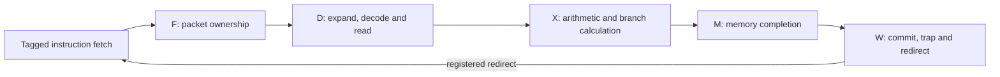
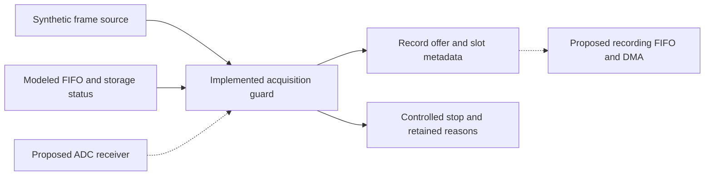
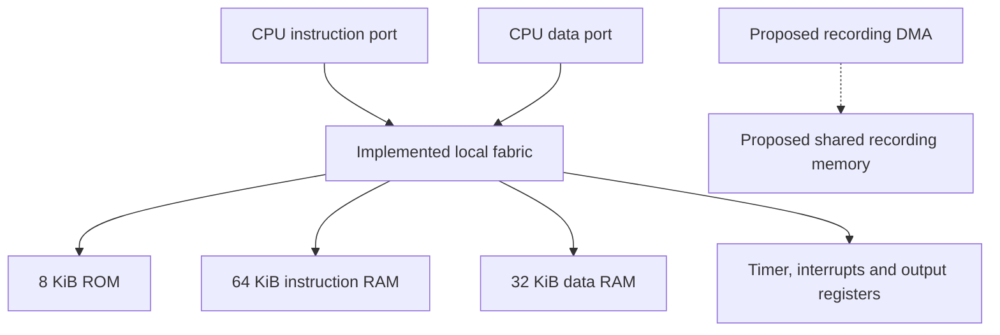
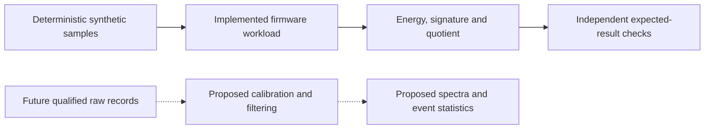
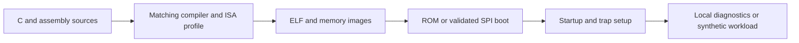
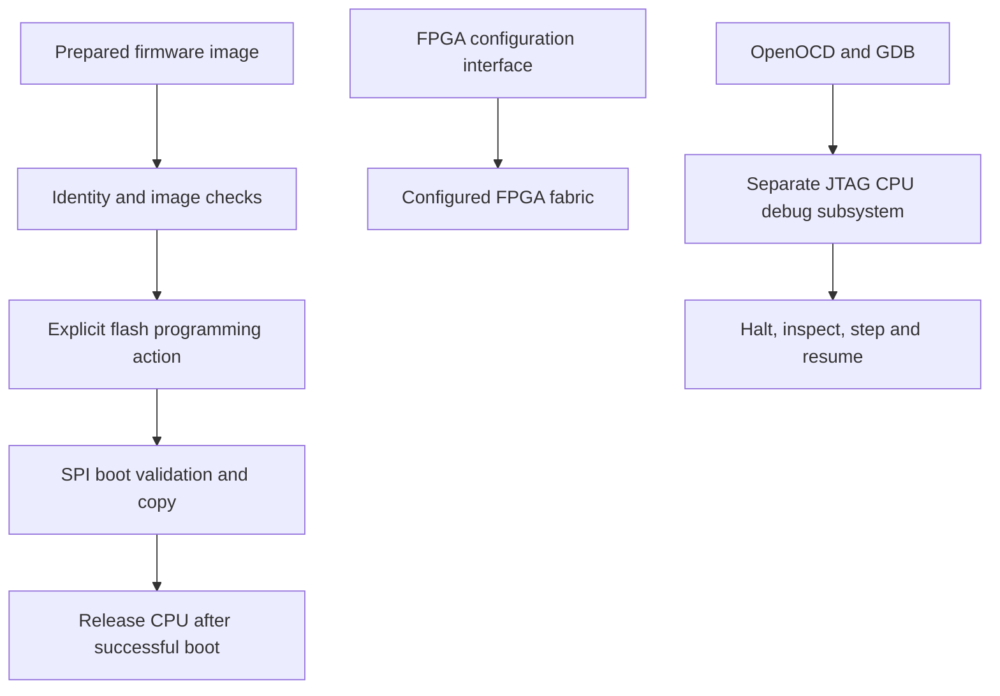
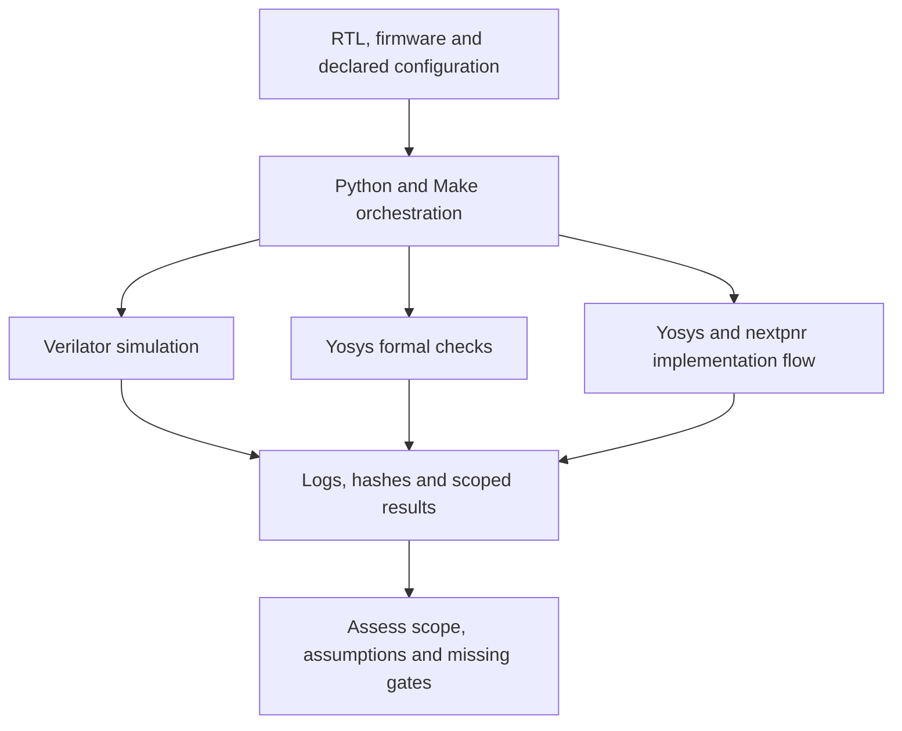

# DRG5 microcontroller

DRG5 is a custom RISC-V microcontroller implementation intended to support a future dorsal root ganglion signal processor. The current source provides a five-stage CPU, local memories and peripherals, firmware, simulation and formal verification tools, and FPGA programming support. The complete ADC acquisition engine, recording memory subsystem and biological signal-processing chain remain development targets. Extracellular cultures provide the starting assumption for the eventual recording source; the electrical connection and recording protocol remain unresolved.

## Table of contents

| Section |
| --- |
| [CPU](#cpu) |
| [Acquisition](#acquisition) |
| [Memory](#memory) |
| [Signal processing](#signal-processing) |
| [Firmware](#firmware) |
| [Programming and debug](#programming-and-debug) |
| [Verification and tools](#verification-and-tools) |

The intended system keeps acquisition timing independent of CPU execution. That separation is required to preserve sample timing when software stalls or enters an interrupt handler, and to retain timing and stop evidence when debug requests a controlled recording stop. The current acquisition supervisor exercises this boundary with synthetic inputs. It does not contain an AD7606C-18 serial receiver or a complete recording DMA engine.

| Area | Current implementation | Detailed description |
| --- | --- | --- |
| CPU | Five-stage in-order RTL with configurable integer multiply/divide, compressed instructions, machine interrupts and debug. | [CPU and RTL](rtl/README.md) |
| Acquisition | Connected control/timebase/slot scheduling, single-clock record reservations, a separate synthetic guard, and capture models. | [Acquisition](acquisition/README.md) |
| Memory | Local synchronous ROM, instruction RAM, data RAM and memory-mapped peripherals. | [Memory](memory/README.md) |
| Signal processing | A deterministic firmware workload for CPU and data-integrity checks. | [Signal processing](signal-processing/README.md) |
| Firmware | Startup, trap handling, local platform checks and synthetic processing programs. | [Firmware sources](firmware/) |
| Programming and debug | Image preparation, SPI boot, programming guards and a separate JTAG debug subsystem. | [Programming sources](programming/) |
| Verification | Directed simulation, scoped formal properties, reference comparison and retained test records. | [Verification sources](verification/) and [test records](tests/evidence/) |

## CPU

The CPU accepts raw instructions through a tagged fetch interface and advances them through F, D, X, M and W ownership stages. Decode and compressed expansion occur in D. Arithmetic and branch calculation occur in X, memory completion occurs through M, and architectural updates occur at W. Taken branch and jump redirects are committed at W in the current implementation.

The [control module](rtl/drg5_control.sv) provides configurable features; its parameter defaults do not describe every system wrapper. The [local system](rtl/drg5_soc.sv) enables M and C by default and explicitly enables machine interrupts, the platform timer and instruction synchronization. Its CPU debug inputs are disabled. The [debug wrapper](rtl/drg5_debug_system.sv) and its simulation fixtures provide a distinct integration path.

| Responsibility | Responsible source | Implementation boundary |
| --- | --- | --- |
| Instruction fetch and assembly | [Frontend](rtl/drg5_frontend.sv), [fetch manager](rtl/drg5_fetch.sv) and [parcel buffer](rtl/drg5_fetch_buffer.sv) | Obsolete responses drain through their existing request owner. |
| Decode and execution | [Control](rtl/drg5_control.sv), [decoder](rtl/drg5_decoder.sv), [decompressor](rtl/drg5_decompress.sv), [ALU](rtl/drg5_alu.sv) and [multiply/divide unit](rtl/drg5_muldiv.sv) | Enabled extensions depend on the instantiated profile. |
| Architectural state | [Control](rtl/drg5_control.sv) and [CSR bank](rtl/drg5_csr.sv) | One hart executes in machine mode; the code does not provide a memory-management unit or floating-point unit. |
| Detailed diagrams | [CPU implementation and interfaces](rtl/README.md) | The diagrams distinguish CPU RTL from proposed acquisition connections. |

## Acquisition

The [acquisition guard](rtl/drg5_acquisition_guard.sv) tracks scheduled slots, frame identity, invalid records, retained counts and stop reasons. Its current profile accepts an 80 MHz clock with 1600 cycles per slot, which corresponds to 50,000 scheduled slots per second. This is an explicit implementation constraint of the synthetic supervisor. It does not establish that a complete acquisition system meets that rate on an FPGA.

The guard receives frame and storage-status inputs from its environment. Its clock and retained observations are independent of CPU reset and halt requests; those requests initiate controlled stopping. The complete design still requires ADC waveform generation and reception, status and CRC validation, storage ownership, DMA, and a validated analog source interface.

| Responsibility | Responsible source | Current boundary |
| --- | --- | --- |
| Lifecycle, configuration and timing | [Timing wrapper](rtl/drg5_acquisition_timing.sv), [control peripheral](rtl/drg5_acquisition_control.sv) and [scheduler](rtl/drg5_acquisition_scheduler.sv) | Connected synchronous RTL; CPU fabric, ADC service/capture and memory backends remain external. |
| Record reservations and DMA staging | [Record ledger](rtl/drg5_acquisition_records.sv) and [storage adapter](rtl/drg5_acquisition_storage.sv) | Complete-record ownership with synthetic peers; asynchronous crossing and actual DMA remain external. |
| Slot identity and stop accounting | [Acquisition guard](rtl/drg5_acquisition_guard.sv) | Implemented RTL with an explicit synthetic profile. |
| Guard verification | [Guard runner](tests/run_acquisition_guard.py) and [simulation driver](tests/acquisition_guard_sim.cpp) | Tests modeled frame and storage responses. |
| Capture and transport stress | [Stress model](synthetic/stress.cpp) and [runner](synthetic/run_stress.py) | Software modeling is distinct from executing the complete acquisition path in RTL. |
| ADC receiver and recording DMA | [Acquisition architecture](acquisition/README.md) | Proposed modules; the local board wrappers do not acquire ADC data. |

## Memory

The [local fabric](rtl/drg5_local_fabric.sv) supplies 8 KiB of ROM, 64 KiB of instruction RAM and 32 KiB of data RAM. Its instruction and data interfaces retain request identity through acceptance and response. Naturally aligned data accesses use explicit byte lanes, and peripheral effects occur once at acceptance. This local platform is sufficient for the supplied firmware fixtures.

The larger recording memory design includes ownership, publication, arbitration and error-containment requirements. Those requirements do not imply that a DMA ring, external RAM controller or error-correcting memory is present in the local fabric.

| Resource | Responsible source | Current behavior |
| --- | --- | --- |
| ROM and RAM | [Local fabric](rtl/drg5_local_fabric.sv) | Synchronous reads; ordinary storage is not cleared by CPU reset. |
| Timer and interrupt registers | [Interrupt platform](rtl/drg5_irq_platform.sv) | Retained events, timer state and defined register effects. |
| CPU access checks | [Load/store helper](rtl/drg5_lsu.sv) and [control](rtl/drg5_control.sv) | Alignment, region checks, transaction ownership and completion handling. |
| Recording storage | [Memory architecture](memory/README.md) | Proposed shared storage and publication services beyond the local platform. |

## Signal processing

The current [synthetic kernel](firmware/synthetic/kernel.h) uses deterministic signed 18-bit values, a three-tap second difference, unsigned modulo-32 energy accumulation and a signature. It is a bounded workload for instruction execution and data-integrity checks. Its wrapped energy is not a calibrated physical measurement, and its sampling stride is not an anti-alias filter.

The proposed processing chain preserves immutable raw records and creates calibrated derived values with explicit validity, filter state and provenance. Frequency analysis and spike statistics require their own numerical reference tests and a qualified signal source. The current implementation does not establish a biomarker, natural oscillator, pathological change or therapeutic effect.

| Responsibility | Responsible source | Current boundary |
| --- | --- | --- |
| Synthetic samples and arithmetic | [Kernel](firmware/synthetic/kernel.h) | Deterministic workload with explicitly wrapped arithmetic. |
| Firmware execution | [Synthetic program](firmware/synthetic/main.c) and [CPU simulation driver](tests/synthetic_cpu_sim.cpp) | CPU RTL executes a limited modeled workload. |
| Model assessment | [Synthetic audit](synthetic/audit_synthetic.py) | Assesses the model's declared accounting and output records. |
| Filters, spectra and event statistics | [Signal-processing architecture](signal-processing/README.md) | Proposed signal-analysis pipeline requiring independent validation. |

## Firmware

The firmware uses an ILP32, little-endian, soft-float environment. Startup and trap assembly define the execution boundary before C code accesses the local platform. The build script selects the instruction profile and emits the images required by simulation and boot tooling.

A firmware build should use an instruction profile that matches the instantiated CPU. The [build script](firmware/build.py) exposes its options through `python3 microcontroller/firmware/build.py --help` from the repository root. The source tree contains test programs and a private runtime; it does not provide a complete recording application or operating system.

| Responsibility | Responsible source | Purpose |
| --- | --- | --- |
| Startup and memory layout | [Startup assembly](firmware/start.S) and [linker script](firmware/link.ld) | Establish registers, stack and initialized program state. |
| Exception and interrupt entry | [Trap assembly](firmware/trap.S) and [platform definitions](firmware/platform.h) | Connect machine traps to the local platform convention. |
| Local diagnostics | [Main program](firmware/main.c), [probes](firmware/probes.S) and [runtime](firmware/runtime.c) | Exercise compiled code and platform behavior. |
| Image generation | [Build script](firmware/build.py) | Bind compiler options, linked output and memory images. |

## Programming and debug

FPGA configuration, CPU firmware storage and CPU debug are separate interfaces. The programmable wrapper keeps the CPU in reset while the SPI loader validates and copies a firmware image. A programming operation must identify the intended board and exact image before a hardware command is issued.

The separate debug subsystem implements halt, resume, stepping, abstract register access and bounded system-bus access. Its presence in the source tree does not mean that the programmable FPGA wrapper exposes the same debug path. Physical programming, power-cycle recovery and debug interoperability on the intended board require measured evidence.

| Responsibility | Responsible source | Current boundary |
| --- | --- | --- |
| Image preparation and identity | [Image tool](programming/image.py) and [inventory example](programming/inventory.example.json) | Image metadata and target checks precede programming. |
| Hardware programming | [Programming tool](programming/program_board.py) | Review its selected action and required inventory before any hardware operation. |
| Firmware boot | [SPI loader](rtl/drg5_spi_boot.sv) and [programmable system](rtl/drg5_programmable_system.sv) | CPU release depends on successful boot validation. |
| CPU debug | [Debug transport](rtl/drg5_debug_transport.sv), [module](rtl/drg5_debug_module.sv) and [system wrapper](rtl/drg5_debug_system.sv) | Distinct from the FPGA configuration interface. |

## Verification and tools

The verification code uses free and open-source tools suitable for Ubuntu. Python runners organize builds, simulation cases, formal checks and result collection; SystemVerilog benches and C++ drivers provide the hardware stimulus and observations. These roles are separate from the RTL being evaluated.

A useful component entry point is `python3 microcontroller/tests/run_csr.py --verilator verilator --yosys yosys --build /tmp/drg5-csr-public`. This creates a new local result set when compatible tools are installed. The [runner](tests/run_csr.py) requires both intended positive outcomes and specific failures from its negative controls. A new result set records source hashes, tools, assumptions and scope. The standalone-bank result is separate from instruction decoding and pipeline integration, and it is not a complete-CPU correctness claim.

| Verification area | Responsible source | Evidence limit |
| --- | --- | --- |
| Directed simulation | [Test targets](tests/Makefile) and [directed runner](verification/run_directed.py) | Results apply to the selected profiles, stimuli and source versions. |
| Formal properties | [Formal runners and harnesses](verification/formal/) | Proof claims depend on the harness, assumptions and property set. |
| Architectural comparison | [Execution comparison](verification/execution/comparison.py) and [reference runner](verification/execution/run_random.py) | Reference-model policy and instruction applicability must match the CPU. |
| Architectural tests | [ACT4 campaign code](verification/act4/) | Source presence does not establish a completed conformance campaign. |
| FPGA mapping and routing | [Synthesis sources](synth/) and [FPGA wrappers](synth/fpga/) | Mapping, routing and physical board behavior are separate checks. |
| Retained component results | [Test evidence](tests/evidence/) and [register-file mapping evidence](synth/evidence/register-file-2026-11-04/summary.json) | Captured results remain attributable to their recorded inputs. |

The broader campaign and release helpers may require external tools or input archives that are not included in this checkout. Their command definitions and prerequisites must be checked before execution. A missing input is an unavailable check, rather than a passing result. The [CPU](rtl/README.md), [acquisition](acquisition/README.md), [memory](memory/README.md) and [signal-processing](signal-processing/README.md) guides contain the subsystem diagrams. The [development workflow](../docs/pre-coding-workflow.md) describes the remaining design work.
