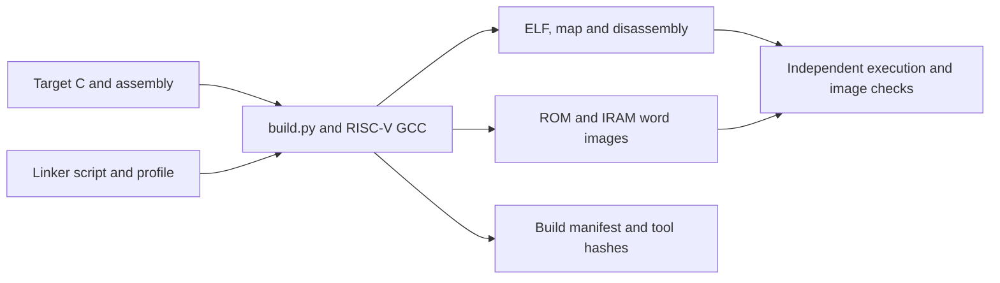

# Firmware

## Purpose

This directory contains freestanding firmware for the local DRG5 CPU platform. The application exercises startup, traps, interrupts and memory behavior; it does not acquire biological signals or control a stimulator. The separate [synthetic workload](synthetic/README.md) exercises the CPU alongside modeled acquisition traffic.

## Instructions

Run commands from the repository root. Use Python 3 and a RISC-V GCC/binutils installation that supports the exact architecture attributes checked by [build.py](build.py). The recorded compiler family is xPack RISC-V GCC 15.2.0-1, with GCC 15.2.0 and binutils 2.45. The default installation prefix is `/tmp/drg5-arch-tools/gcc/xpack-riscv-none-elf-gcc-15.2.0-1/bin/riscv-none-elf-`; pass `--prefix` to select another installation. A different toolchain requires a new successful build and audit rather than inheriting earlier results.

The following command creates files in a new, empty output directory. It does not program hardware.

```sh
python3 microcontroller/firmware/build.py \
  --profile imc \
  --prefix /tmp/drg5-arch-tools/gcc/xpack-riscv-none-elf-gcc-15.2.0-1/bin/riscv-none-elf- \
  --output /tmp/drg5-firmware-new
```

The `imc` profile selects RV32I 2.1, M 2.0, C 2.0, Zicsr 2.0 and Zifencei 2.0 with the soft-float `ilp32` ABI. The `i` profile omits M and C and must run on its matching CPU configuration. Both profiles enforce strict alignment, disable relaxation and hosted libraries, and inspect object, archive and ELF attributes. The `--negative` options deliberately break data initialization, BSS initialization or interrupt-context restoration for detector tests; they are not application configurations.

Read `build.json` together with the compiler logs, `firmware.map`, disassembly logs and `symbols.json`. A successful build establishes image and compiler checks, while [platform tests](../tests/README.md) establish execution behavior. The generated `rom.hex` and `iram.hex` contain ROM and instruction-memory initialization only. Startup must copy initialized data and clear BSS; the builder does not preload data RAM to conceal a startup defect.

The available execution evidence comes from the Ubuntu/Linux tool environment. Native Windows, WSL and macOS execution have not been validated. Some higher-level runners require the fixed Linux tool layout even though this builder accepts a compiler prefix.

## Implementation

| Source | Responsibility |
| --- | --- |
| [build.py](build.py) | Orchestrates compilation, linking, image extraction, tool identification and manifest generation. It is the host wrapper, not target firmware. |
| [start.S](start.S) and [link.ld](link.ld) | Establish startup and memory layout, including the data-copy and BSS ranges. |
| [trap.S](trap.S) and [probes.S](probes.S) | Implement target exception entry, restoration and directed instruction probes. |
| [main.c](main.c) and [platform.h](platform.h) | Implement the test application and its platform interface. |
| [runtime.c](runtime.c) | Supplies the explicitly linked local runtime archive without an implicit C library. |
| [synthetic/](synthetic/README.md) | Supplies a separately compiled simulation workload with a bounded integer kernel. |


