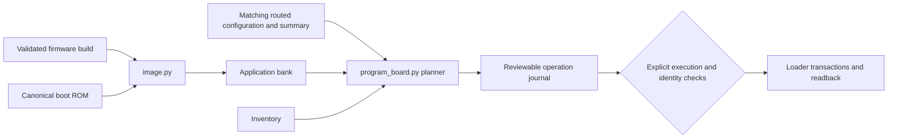

# Configuration and firmware image preparation

## Table of contents

| Section |
| --- |
| [Purpose](#purpose) |
| [Instructions](#instructions) |
| [Implementation](#implementation) |

## Purpose

This directory separates FPGA configuration from CPU firmware. A configuration bitstream defines the hardware and boot ROM; an application bank supplies instruction-memory contents for that compatible boot design. The current programming contract names ULX3S v3.1.7 D&M, LFE5U-85F-6BG381C and W25Q128JVSIQ. Those source constants do not establish the identity or readiness of an attached board.

## Instructions

[image.py](image.py) validates a completed `imc` firmware build and creates a bank file using the canonical [boot-rom.hex](boot-rom.hex). It checks ELF and image provenance, ROM compatibility, sizes, entry points, CRCs and generation fields. This operation writes host files only. Obtain the exact input paths from the new [firmware build](../firmware/README.md), then inspect the image builder's interface:

```sh
python3 microcontroller/programming/image.py --help
python3 microcontroller/programming/program_board.py --help
```

[program_board.py](program_board.py) defaults to planning. A plan still requires a matching routed configuration, its route summary, the canonical ROM, a board inventory and, for firmware-update operations, a validated bank. The following example prepares a volatile-configuration plan; the bitstream and summary paths must come from the same successful [programmable synthesis run](../synth/README.md).

```sh
python3 microcontroller/programming/program_board.py config-sram \
  --configuration /tmp/drg5-programmable-new/route/drg5.bit \
  --route-summary /tmp/drg5-programmable-new/route/summary.json \
  --inventory microcontroller/programming/inventory.example.json \
  --output /tmp/drg5-program-plan-new
```

The example inventory intentionally has an unverified physical inspection and placeholder serial. It can describe a plan, but cannot authorize selection of a physical programmer. Review `operation.json`, the copied input identities and the declared erase/write ranges. Planning does not contact a board. Adding `--execute` changes the operation to hardware access and requires an inspected inventory and the exact supported loader identities; the commands above do not select that mode.

An executed operation retains a journal and distinguishes completion of a write/readback from power-cycle and application observations. A programming failure does not trigger a blind write retry. [audit_programming.py](audit_programming.py) inspects a complete supplied evidence bundle; a plan alone cannot satisfy its simulation, routing and hardware-observation requirements. No physical programming or boot qualification is established by the publication's source files.

The loader integration and executable hashes target the Ubuntu/Linux installation used during development. Native Windows, WSL and macOS hardware access have not been validated.

## Implementation

| Source | Responsibility |
| --- | --- |
| [image.py](image.py) | Implements bank encoding, validation, generation selection and image-building orchestration. |
| [program_board.py](program_board.py) | Implements the host operation planner and optional loader transaction sequence. |
| [boot-rom.hex](boot-rom.hex) | Supplies the fixed boot-ROM word image checked by the bank and routing contracts. |
| [inventory.example.json](inventory.example.json) | Shows the required board identity fields without claiming inspection. |
| [audit_programming.py](audit_programming.py) | Reconstructs qualification evidence; it does not perform programming. |
| [drg5_spi_boot.sv](../rtl/drg5_spi_boot.sv) | Implements the target SPI boot behavior exercised by the programming simulations. |

Each application bank occupies 128 KiB: A starts at flash offset `0x400000`, and B at `0x420000`. The format includes a 256-byte header, a 64 KiB payload and a separate final 4 KiB commit sector. Normal firmware updates use B and preserve the golden A bank; golden restoration and deliberate corruption/invalidation are distinct service modes. CRC and SHA-256 fields establish integrity and artifact identity, not firmware authentication.


