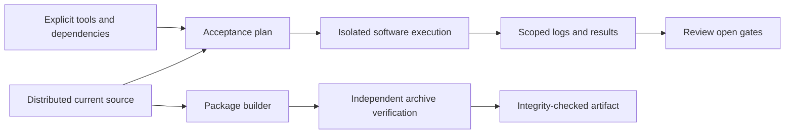

# Release preparation and acceptance planning

## Table of contents

1. [Purpose](#purpose)
2. [Instructions](#instructions)
3. [Implementation](#implementation)

## Purpose

These tools prepare isolated acceptance runs, install tools from an explicit dependency manifest, and package the distributed source and documentation with byte-level verification. Packaging is an integrity operation. Its manifests deliberately keep `overall_system_pass` false; a reproducible archive does not establish CPU or board qualification.

## Instructions

Run commands from the repository root using Python 3 in the Ubuntu/Linux environment. Acceptance execution also needs the tools required by each selected suite. Process supervision, the isolated Ruby setup and several child runners use Linux-specific paths and facilities. Native Windows, WSL and macOS have not been validated.

[acceptance.py](acceptance.py) prints a plan unless `--execute` is supplied. Planning exposes the exact child commands, tool paths, selected scope and output workspace without launching hardware operations:

```sh
python3 microcontroller/release/acceptance.py \
  --suite units \
  --tools /tmp/drg5-control-tools-20260301/oss-cad-suite \
  --output /tmp/drg5-acceptance-units-new
```

The output location must be new, must not overlap a sealed evidence directory, and must satisfy the runner's restricted path syntax. A location inside the checkout is permitted only under `.release-runs/`. Execution copies the selected current source into a separate workspace, runs the planned software checks with timeouts and retains logs, hashes and a summary. Review the printed plan before adding `--execute`; use a new output directory for each attempt.

The suite names cover smoke, units, firmware, directed, formal, reference, architectural, synthetic, debug, debug-host and route checks. `all` combines their jobs; it does not turn open architectural omissions or untested physical behavior into a release pass. Several child runners fix the GCC, architectural-tool or OSS CAD Suite location. The planner rejects incompatible overrides for affected suites. Its default smoke suite includes compiler, boot and modeled-acquisition dependencies, so it is not a Python-only self-test.

[bootstrap_tools.py](bootstrap_tools.py) requires `--root` and an explicit `--manifest`. The complete dependency manifest is not distributed here. Consequently, this checkout cannot independently reproduce that installer from a documented download command alone. A supplied manifest must define the expected archive/package hashes and installation layout; the bootstrap checks those inputs, uses a new installation root, and retains success or failure logs. `--cache` selects existing downloads and `--download` permits network retrieval. It does not infer substitute versions when inputs are absent.

[package_release.py](package_release.py) can create and verify an archive independently of compiler installation. The following commands package host files only:

```sh
python3 microcontroller/release/package_release.py build \
  --output /tmp/drg5-package-new
python3 microcontroller/release/package_release.py verify \
  --archive /tmp/drg5-package-new/drg5-r1-engineering.tar.gz
```

The package contains the `microcontroller/` and `docs/` trees with a deterministic inventory, normalized permissions and checksums. It does not include root-level project files or the separate `datasheets/` tree, so this archive is not a complete mirror of the repository. Verification checks each declared member, size, mode and digest. Optional `--extract` requires a nonexistent destination. A package preserves exactly the included captured evidence; it does not create absent campaign records or refresh old source attribution.

## Implementation

| Source | Responsibility |
| --- | --- |
| [acceptance.py](acceptance.py) | Builds a fixed software-only command plan, snapshots sources and supervises isolated jobs. |
| [bootstrap_tools.py](bootstrap_tools.py) | Installs and checks an explicit dependency set under a new installation root. |
| [package_release.py](package_release.py) | Implements deterministic packaging, inventory validation and optional verified extraction. |
| [test_acceptance.py](test_acceptance.py) | Checks acceptance planning, source isolation and supervision behavior. |
| [test_bootstrap_tools.py](test_bootstrap_tools.py) | Checks dependency-bootstrap handling without supplying a complete install manifest. |
| [test_package_release.py](test_package_release.py) | Checks archive integrity and rejection of malformed inputs. |


