# DRG5 CPU and RTL

The RTL implements a custom, single-hart, five-stage RISC-V processor and several platform wrappers. The CPU operates in machine mode and provides an integer datapath, tagged instruction and data interfaces, precise architectural retirement, configurable M and C execution, machine interrupts, instruction synchronization and optional debug. The broader microcontroller adds local memory, boot and diagnostic interfaces around this core.

The [acquisition control peripheral](drg5_acquisition_control.sv) implements lifecycle commands, configuration publication, coherent snapshots and retained fault evidence. Its [register and backend interface](../acquisition/control-foundation.md) defines the component boundary. [drg5_acquisition_timing.sv](drg5_acquisition_timing.sv) connects it to the shared [timebase](drg5_acquisition_timebase.sv) and [slot scheduler](drg5_acquisition_scheduler.sv). The CPU wrappers do not instantiate this connected path yet; the existing synthetic acquisition guard remains a separate component.

The [record ledger](drg5_acquisition_records.sv) and [storage adapter](drg5_acquisition_storage.sv) add reserved, ordered complete-record storage with synthetic capture and DMA peers. They run on one acquisition clock and preserve owners through backpressure and cancellation. Their [integration contract](../acquisition/storage-integration.md) leaves asynchronous FIFO qualification, actual DMA writes and CPU board connection open.

## Table of contents

| Section |
| --- |
| [CPU boundary](#cpu-boundary) |
| [Five-stage pipeline](#five-stage-pipeline) |
| [Pipeline control and retirement](#pipeline-control-and-retirement) |
| [Elastic stage transfer](#elastic-stage-transfer) |
| [CPU-01 · Reset, PC and redirects](#cpu-01--reset-pc-and-redirects) |
| [CPU-02 · Fetch adapter and buffer](#cpu-02--fetch-adapter-and-buffer) |
| [CPU-03 · Alignment and compressed instructions](#cpu-03--alignment-and-compressed-instructions) |
| [CPU-04 · Decoder and immediates](#cpu-04--decoder-and-immediates) |
| [CPU-05 · Register file](#cpu-05--register-file) |
| [CPU-06 · Forwarding and hazards](#cpu-06--forwarding-and-hazards) |
| [CPU-07 · ALU and shifter](#cpu-07--alu-and-shifter) |
| [CPU-08 · Branches and jumps](#cpu-08--branches-and-jumps) |
| [CPU-09 · Multiplier](#cpu-09--multiplier) |
| [CPU-10 · Divide and remainder](#cpu-10--divide-and-remainder) |
| [CPU-11 · Load/store unit](#cpu-11--loadstore-unit) |
| [CPU-11 · First-valid MMIO obligation](#cpu-11--first-valid-mmio-obligation) |
| [CPU-12 · Retirement and precise traps](#cpu-12--retirement-and-precise-traps) |
| [CPU-13 · CSR and system instructions](#cpu-13--csr-and-system-instructions) |
| [CPU-14 · Interrupts and idle](#cpu-14--interrupts-and-idle) |
| [CPU-15 · FENCE and FENCE.I](#cpu-15--fence-and-fencei) |
| [CPU-16 · Counters and trace](#cpu-16--counters-and-trace) |
| [CPU-17 · Debug integration](#cpu-17--debug-integration) |
| [CPU-17 · Halt, resume and single-step](#cpu-17--halt-resume-and-single-step) |
| [CPU verification boundaries](#cpu-verification-boundaries) |

The source distinguishes feature availability from a particular instantiated profile. [drg5_control.sv](drg5_control.sv) disables M, C, interrupts, debug and Zifencei by default and enables its diagnostic single-instruction mode by default. [drg5_soc.sv](drg5_soc.sv) selects overlapping execution, enables M and C by default, and explicitly enables interrupts, the timer and Zifencei. It leaves CPU debug disabled. [drg5_debug_system.sv](drg5_debug_system.sv) supplies a separate debug integration path. A successful test of one profile does not qualify another configuration.

The implementation has real F, D, X, M and W token ownership. The external [frontend](drg5_frontend.sv) fetches and assembles original instruction bytes before presenting a packet to F. Compressed expansion and decode occur in D. Branch targets are calculated in X and carried to W; the current control commits branch and jump redirects at W. No early X-stage branch redirect is implemented.

The numbered CPU responsibilities below are architectural groupings. They are not a promise of one source module per number. The control module owns the integrated register array and data-request manager, while independently testable helpers provide decode, forwarding, arithmetic, alignment and CSR behavior. The separate [register-file module](drg5_regfile.sv) is a component implementation and mapping fixture; it is not instantiated as the register bank inside the current control module.

| Responsibility | Responsible implementation | Selected verification source |
| --- | --- | --- |
| CPU-01, reset, PC and redirects | [Control](drg5_control.sv), [frontend](drg5_frontend.sv) and [fetch](drg5_fetch.sv) | [Control-event runner](../tests/run_control_events.py) |
| CPU-02, fetch ownership and buffering | [Fetch manager](drg5_fetch.sv), [guard](drg5_fetch_guard.sv) and [parcel buffer](drg5_fetch_buffer.sv) | [Fetch runner](../tests/run_fetch.py) and [buffer runner](../tests/run_fetch_buffer.py) |
| CPU-03, instruction length and C expansion | [Fetch buffer](drg5_fetch_buffer.sv), [decompressor](drg5_decompress.sv) and [control](drg5_control.sv) | [Decompression runner](../tests/run_decompress.py) and [mixed-width execution](../tests/run_compressed_execution.py) |
| CPU-04, decode and immediates | [Decoder](drg5_decoder.sv) and [immediate generator](drg5_immediate.sv) | [Datapath bench](../tests/drg5_datapath_tb.sv) |
| CPU-05, architectural registers | [Integrated control state](drg5_control.sv) and [standalone register-file helper](drg5_regfile.sv) | [Base execution](../tests/run_base.py) and [register-file runner](../tests/run_regfile.py) |
| CPU-06, forwarding and hazards | [Forwarding helper](drg5_forward.sv) and [control](drg5_control.sv) | [Forwarding runner](../tests/run_forward.py) |
| CPU-07, integer arithmetic and shifts | [ALU](drg5_alu.sv) and [shifter](drg5_shifter.sv) | [Arithmetic formal runner](../tests/run_arithmetic_formal.py) |
| CPU-08, branches and jumps | [Branch helper](drg5_branch.sv) and [control](drg5_control.sv) | [Branch runner](../tests/run_branch.py) and [control-flow runner](../tests/run_control_flow.py) |
| CPU-09, multiplication | [Multiply/divide unit](drg5_muldiv.sv) | [Unit runner](../tests/run_muldiv.py) |
| CPU-10, division and remainder | [Multiply/divide unit](drg5_muldiv.sv) | [Encoded execution runner](../tests/run_muldiv_control.py) |
| CPU-11, load/store checks and ownership | [Load/store helper](drg5_lsu.sv) and [control](drg5_control.sv) | [LSU runner](../tests/run_lsu.py) and [memory execution runner](../tests/run_memory.py) |
| CPU-12, retirement and traps | [Control](drg5_control.sv) and [packet/trace types](drg5_control_pkg.sv) | [Control-event bench](../tests/drg5_control_events_tb.sv) |
| CPU-13, machine CSRs and system operations | [CSR bank](drg5_csr.sv) and [control](drg5_control.sv) | [CSR runner](../tests/run_csr.py) and [CSR execution runner](../tests/run_csr_control.py) |
| CPU-14, interrupts and idle | [Control](drg5_control.sv) and [interrupt platform](drg5_irq_platform.sv) | [Interrupt execution](../tests/run_irq_control.py) and [fetch interaction](../tests/run_irq_fetch.py) |
| CPU-15, FENCE and FENCE.I | [Control](drg5_control.sv), [frontend](drg5_frontend.sv) and [fetch](drg5_fetch.sv) | [Fence execution runner](../tests/run_fence_execution.py) |
| CPU-16, counters and observations | [CSR bank](drg5_csr.sv), [control](drg5_control.sv) and [observation adapter](drg5_observe.sv) | [Counter execution](../tests/run_counter_execution.py) and [observation runner](../tests/run_observe.py) |
| CPU-17, debug | [Control](drg5_control.sv), [debug module](drg5_debug_module.sv), [transport](drg5_debug_transport.sv) and [wrapper](drg5_debug_system.sv) | [Debug-core runner](../tests/run_debug_core.py) and [host interoperability runner](../tests/run_debug_remote.py) |

The diagrams describe these responsibilities and their ordering. Connections to a complete ADC receiver, recording DMA, recording memory leases or calibrated signal processing remain proposed system integrations. The [acquisition guard](drg5_acquisition_guard.sv) provides a separate synthetic supervisor; it does not turn the CPU into a complete recording system. The [acquisition](../acquisition/README.md), [memory](../memory/README.md) and [signal-processing](../signal-processing/README.md) pages describe those boundaries.

Verification source and retained evidence are provided separately. The [retained component records](../tests/evidence/) identify the captured configurations, tools and source versions. Individual results do not establish full instruction decoding, pipeline arbitration, board timing or biological recording outside their stated scope. The [test Makefile](../tests/Makefile) identifies executable component targets; broader campaigns may require external inputs that are not included.

## CPU boundary

The local CPU and memory path is implemented by [drg5_soc.sv](drg5_soc.sv). The acquisition receiver and DMA shown at the boundary are proposed integrations. The current board wrappers do not instantiate those blocks.

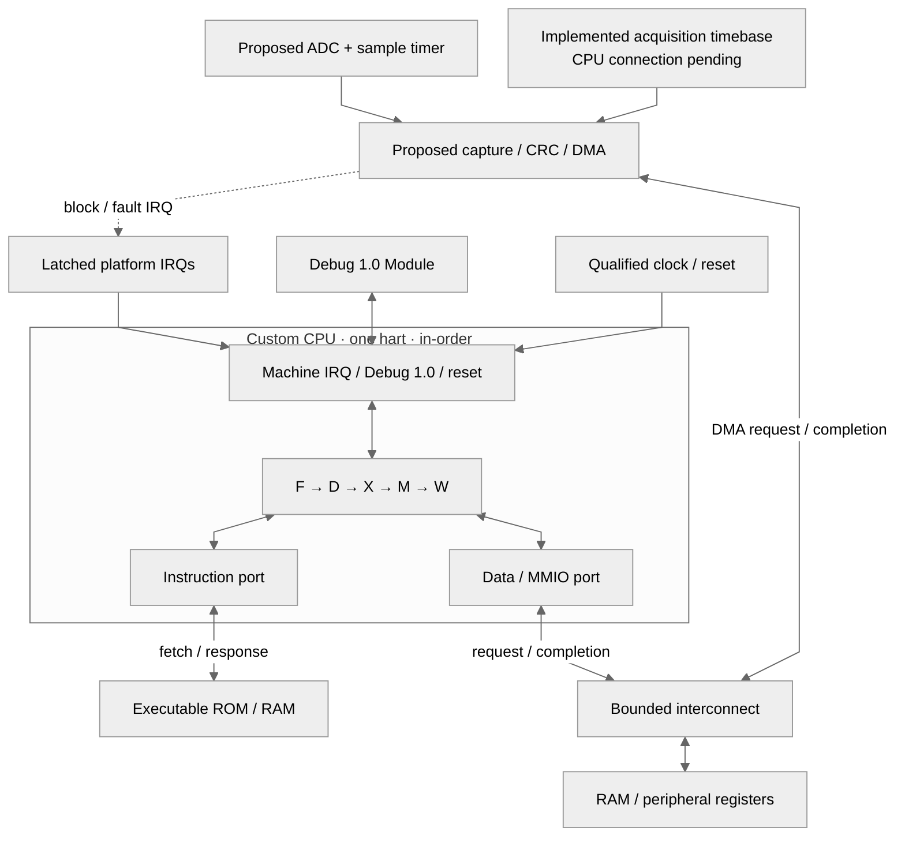

## Five-stage pipeline

The stage ownership is implemented in [drg5_control.sv](drg5_control.sv). [drg5_frontend.sv](drg5_frontend.sv) supplies assembled raw packets; D performs compressed expansion and decode before operand capture.

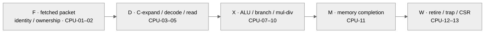

## Pipeline control and retirement

The [control module](drg5_control.sv) selects attempts, applies holds and kills, and commits architectural updates. The branch helper supplies a candidate result in X; redirect publication waits for successful W retirement.

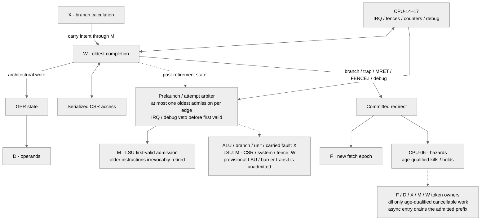

## Elastic stage transfer

The [packet and token types](drg5_control_pkg.sv) and [control logic](drg5_control.sv) separate instruction ownership from surviving memory requests. Debug and interrupt entry drain the admitted prefix before changing the architectural boundary.

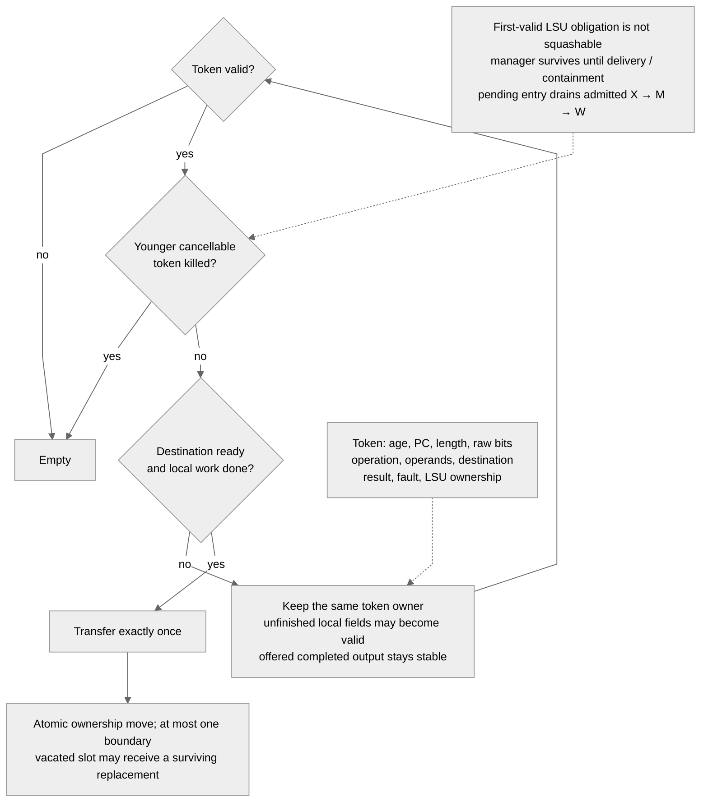

## CPU-01 · Reset, PC and redirects

Reset and redirect behavior is implemented by [control](drg5_control.sv) and [fetch](drg5_fetch.sv). The reset PC defaults to zero and is a parameter. An isolated platform reset and a hart reset have different ownership effects.

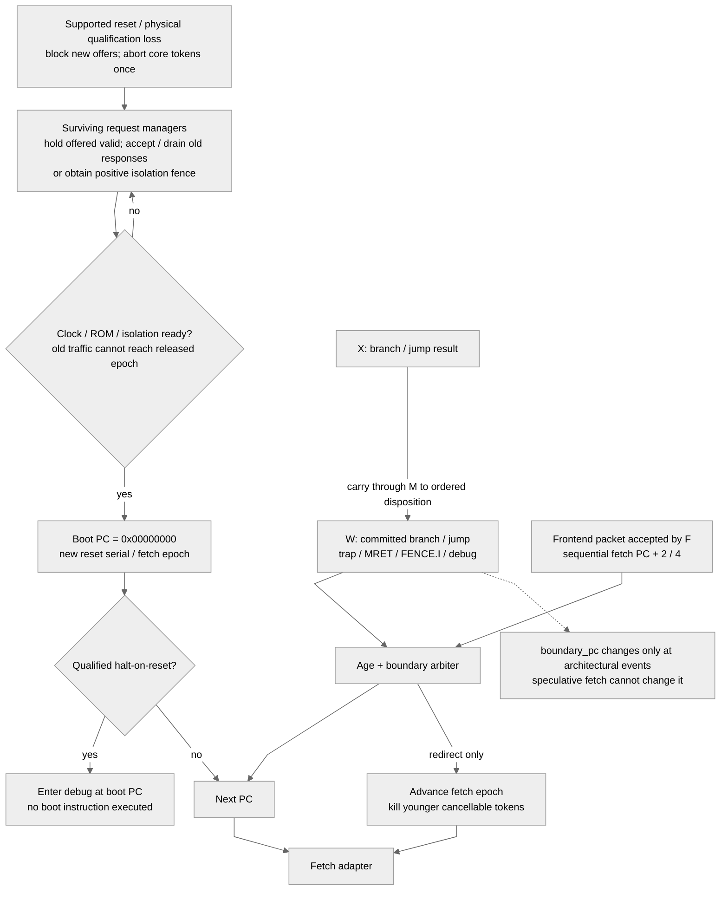

## CPU-02 · Fetch adapter and buffer

The [fetch manager](drg5_fetch.sv), [execute guard](drg5_fetch_guard.sv) and [buffer](drg5_fetch_buffer.sv) retain tags, parcel state and stale-response disposition. Latency and generation widths are configuration parameters rather than fixed performance guarantees.

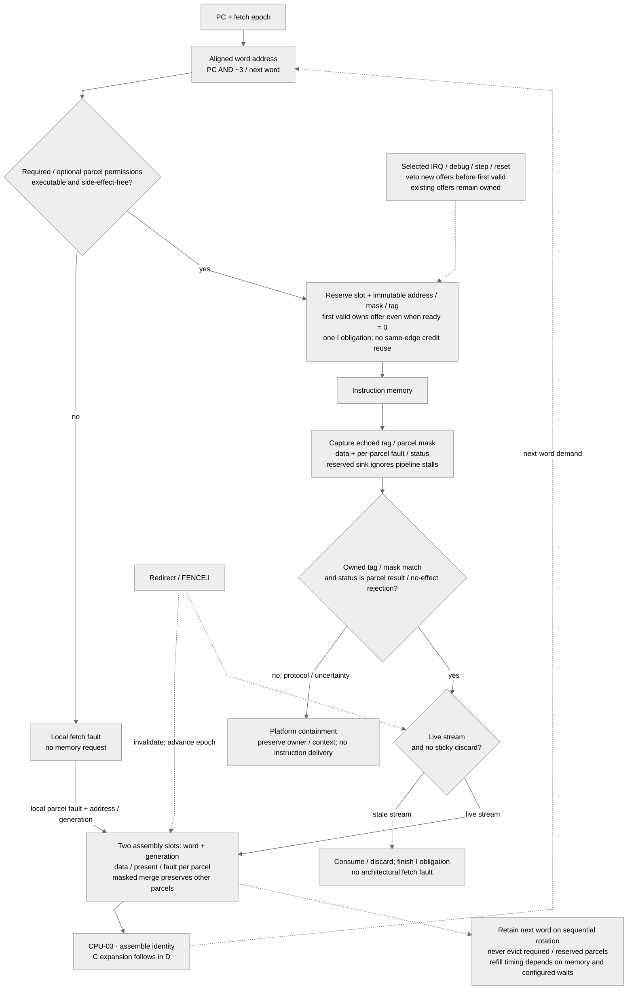

## CPU-03 · Alignment and compressed instructions

The [fetch buffer](drg5_fetch_buffer.sv) determines instruction identity and parcel completeness. The [decompressor](drg5_decompress.sv) is selected by [control](drg5_control.sv) in D when C is enabled. The diagram shows this logical sequence across that module boundary.

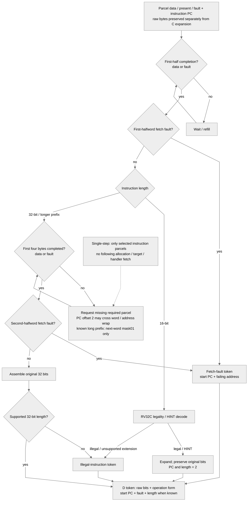

## CPU-04 · Decoder and immediates

The [decoder](drg5_decoder.sv) and [immediate generator](drg5_immediate.sv) supply ordinary integer decode, while [control](drg5_control.sv) handles enabled compressed, machine and multiply/divide forms. Raw instruction identity remains separate from the expanded operation.

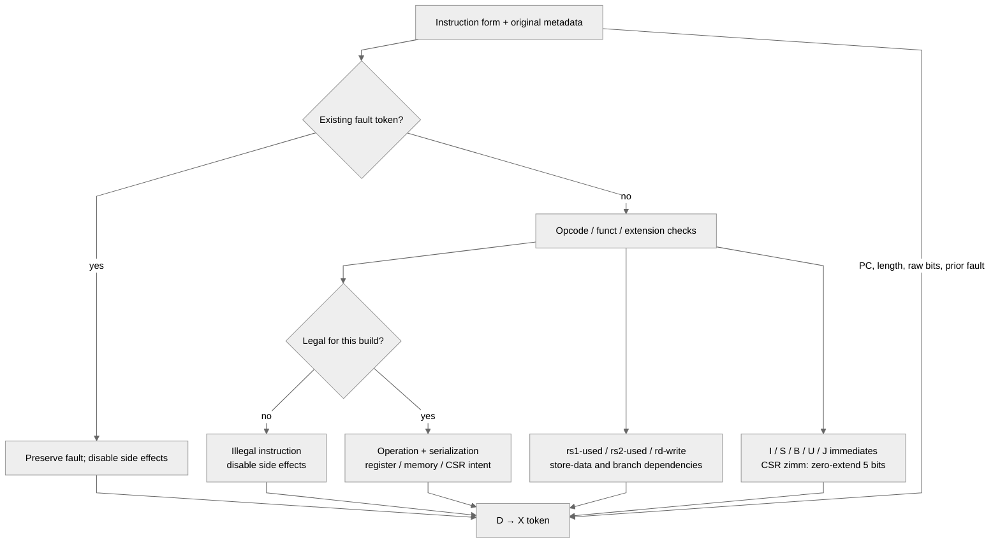

## CPU-05 · Register file

The integrated register array lives in [control](drg5_control.sv), with dependency selection through [forwarding](drg5_forward.sv). The [standalone register-file helper](drg5_regfile.sv) separately demonstrates asynchronous reads, synchronous writes and write-through behavior. Only x0 has an architectural zero value; startup must initialize the nonzero registers it uses.

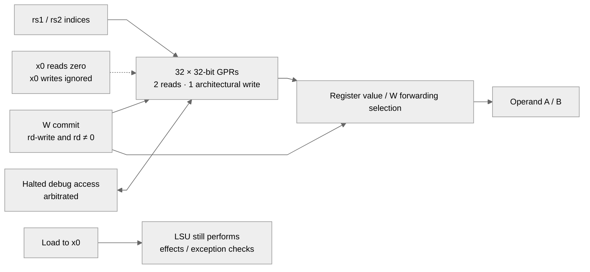

## CPU-06 · Forwarding and hazards

The [forwarding helper](drg5_forward.sv) selects the newest older matching producer independently for each operand. [Control](drg5_control.sv) marks load values ready only after successful completion and retains stalls when a newer matching producer is unavailable.

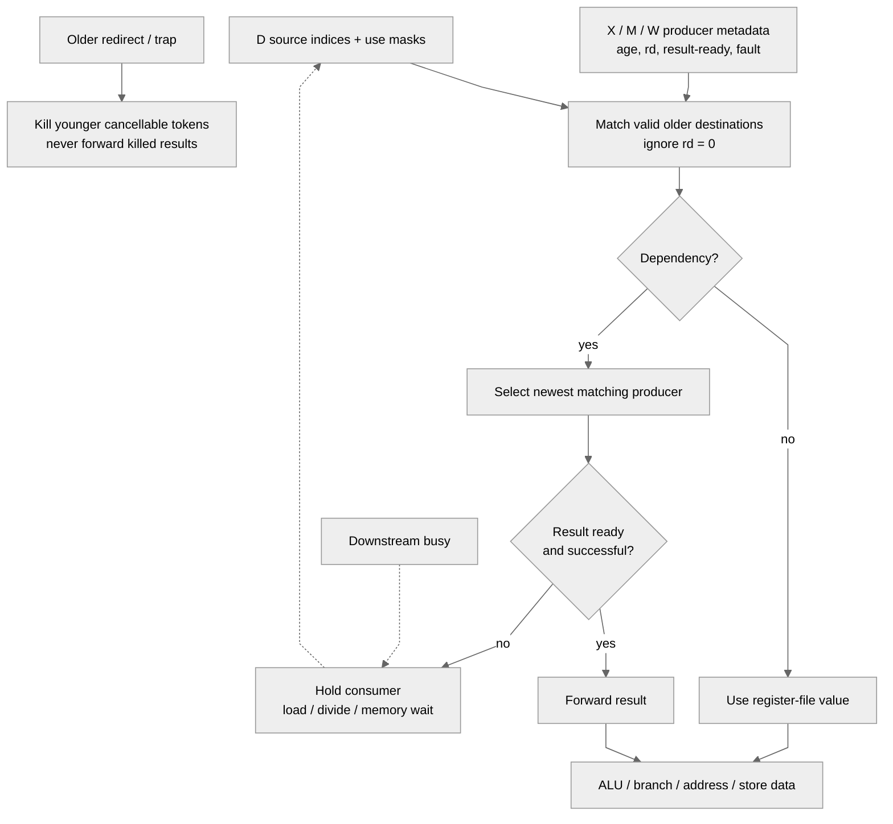

## CPU-07 · ALU and shifter

The [ALU](drg5_alu.sv) and [shifter](drg5_shifter.sv) provide 32-bit integer results. [Control](drg5_control.sv) captures operands and carries results to ordered retirement.

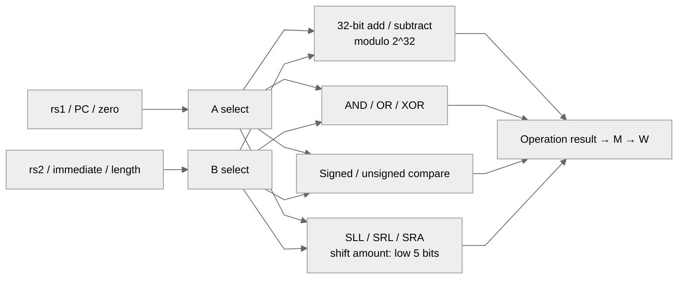

## CPU-08 · Branches and jumps

The [branch helper](drg5_branch.sv) calculates condition, target, link and alignment status in X. [Control](drg5_control.sv) carries that result to W and publishes the redirect on successful retirement. This implementation pays the later redirect cost to retain a single architectural commit point.

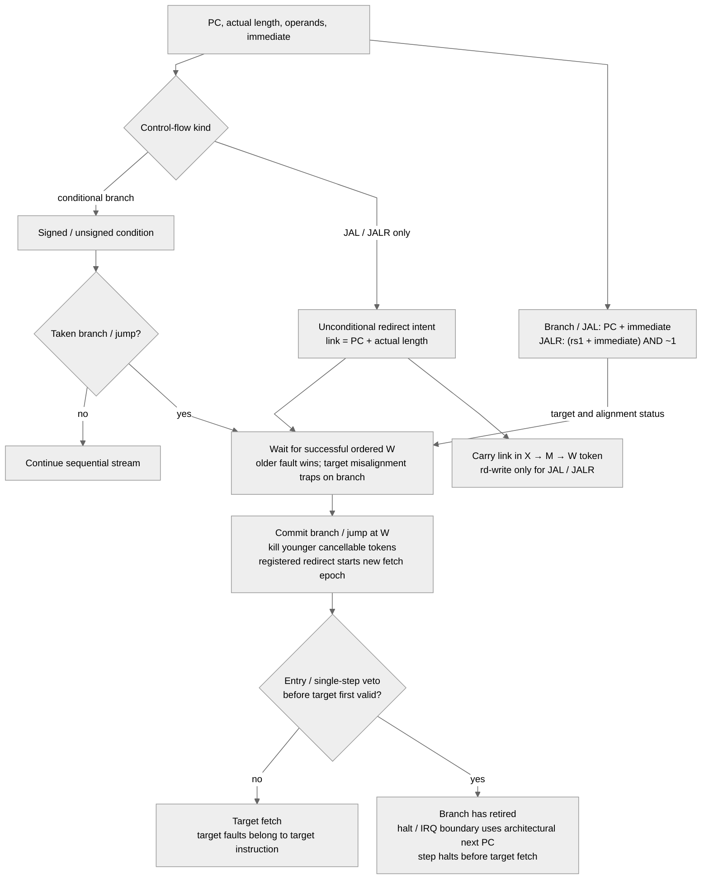

## CPU-09 · Multiplier

Multiplication and division share [drg5_muldiv.sv](drg5_muldiv.sv). The multiplier uses four 16-bit partial products and a registered sum; result-valid begins two clocks after start acceptance. Backpressure can extend the time before consumption, and the complete instruction latency also includes pipeline admission and retirement.

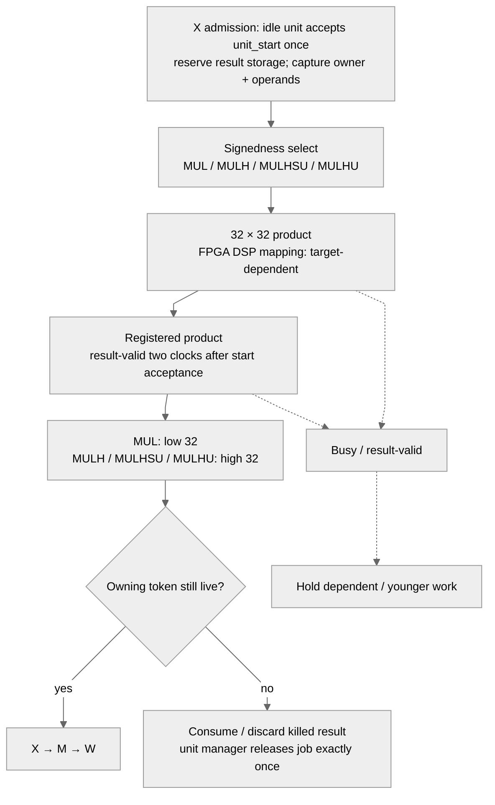

## CPU-10 · Divide and remainder

The [arithmetic unit](drg5_muldiv.sv) performs 32 restoring iterations and a finish edge. Division result-valid begins 33 clocks after start acceptance, including zero-divisor and signed-overflow cases. This is a unit timing statement rather than a complete-program throughput claim.

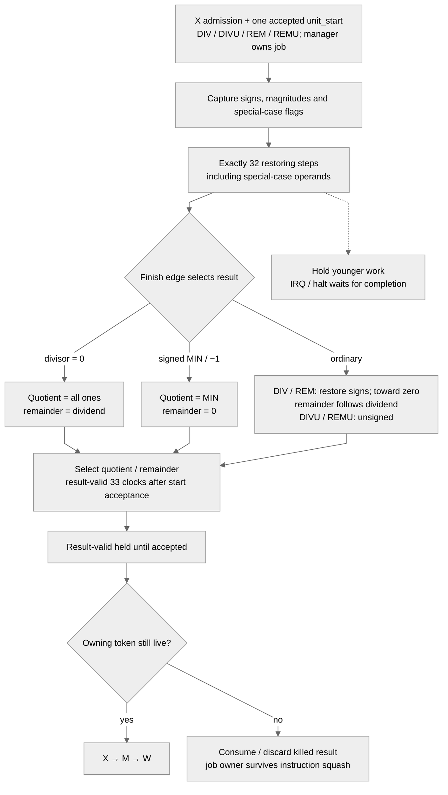

## CPU-11 · Load/store unit

The [LSU helper](drg5_lsu.sv) checks address shape and formats data. The surviving request manager is implemented inside [control](drg5_control.sv). Recording-buffer leases are a proposed system responsibility and are not implemented by this CPU helper.

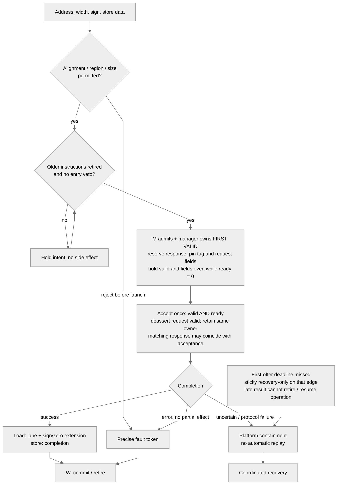

## CPU-11 · First-valid MMIO obligation

The request manager in [control](drg5_control.sv) owns a presented request before acceptance. The [local fabric](drg5_local_fabric.sv) retains its descriptor and produces one response. An interrupt or halt request cannot silently withdraw or replay an effectful operation.

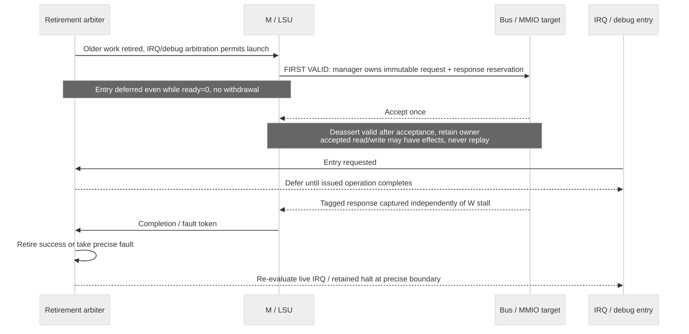

## CPU-12 · Retirement and precise traps

Architectural retirement is controlled by [drg5_control.sv](drg5_control.sv), with trap state in [drg5_csr.sv](drg5_csr.sv). External debug entry for EBREAK also requires the configured debug behavior, including the relevant dcsr control; merely compiling debug support does not redirect every EBREAK to Debug Mode.

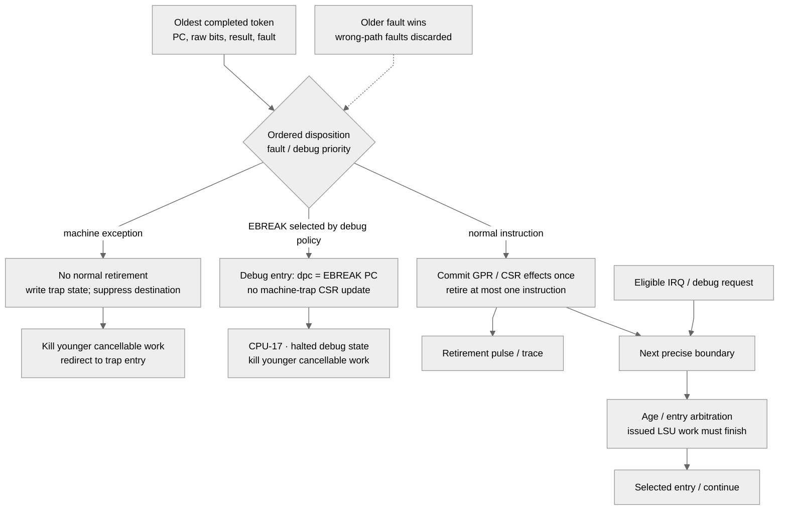

## CPU-13 · CSR and system instructions

The [CSR bank](drg5_csr.sv) implements access permissions and state transitions, while [control](drg5_control.sv) derives instruction read/write suppression and ordered commit. The [CSR integration bench](../tests/drg5_csr_control_tb.sv) checks encoded execution separately from standalone-bank properties.

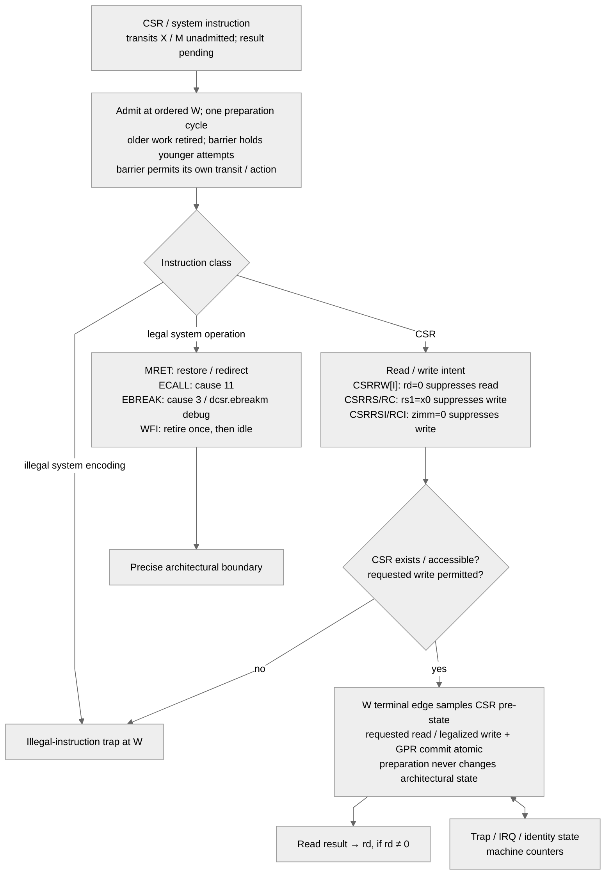

## CPU-14 · Interrupts and idle

The [interrupt platform](drg5_irq_platform.sv) supplies retained software, timer and external state to [control](drg5_control.sv). CPU idle pauses useful instruction issue rather than freezing platform time. Acquisition independence remains a system integration requirement.

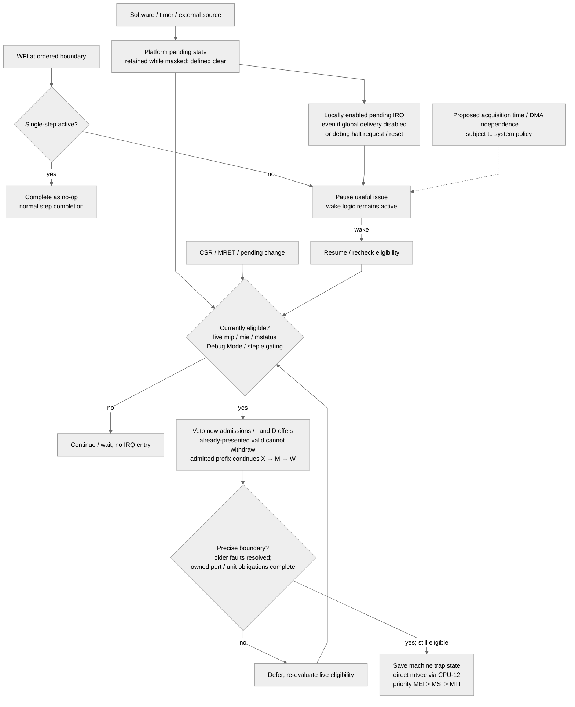

## CPU-15 · FENCE and FENCE.I

The [control module](drg5_control.sv) serializes the CPU's data effects and commits instruction restart. The [fetch manager](drg5_fetch.sv) drains obsolete obligations. Completion of a separate DMA or debug writer must be established before CPU synchronization; a CPU fence does not complete an unrelated transfer.

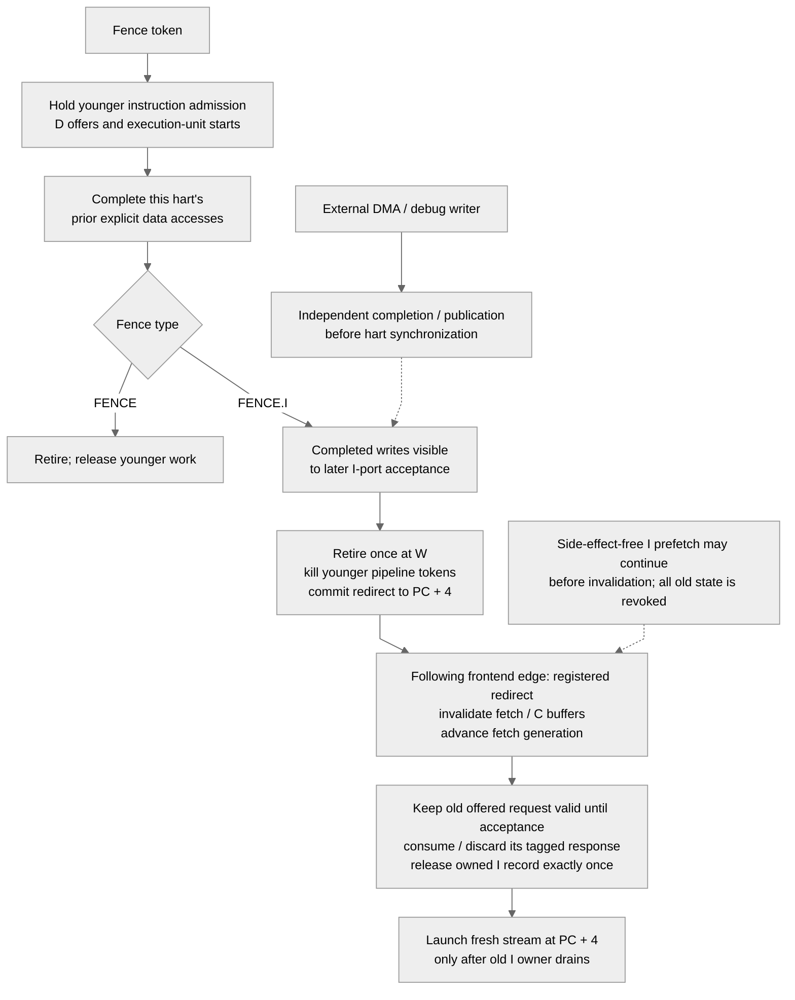

## CPU-16 · Counters and trace

The [CSR bank](drg5_csr.sv) supplies machine cycle and retirement counters. The [observation adapter](drg5_observe.sv) records verification events without applying backpressure to the CPU. It does not implement on-chip trace storage or a standardized RVFI adapter.

```mermaid
%%{init: {"theme":"neutral","themeVariables":{"fontFamily":"Arial,sans-serif","fontSize":"14px"},"flowchart":{"htmlLabels":true,"minNodeWidth":0,"wrappingWidth":240,"nodeSpacing":28,"rankSpacing":32,"curve":"linear"}}}%%
flowchart LR
    CLK["CPU cycles"] --> CYC["mcycle / mcycleh<br/>64-bit; reset zero / inhibited<br/>CSR-defined edge and debug policy"]
    RET["Successful retirement pulse"] --> INST["minstret / minstreth<br/>reset zero / inhibited<br/>compressed instruction counts once"]
    ABSENT["No HPM events / Zicntr / Zihpm<br/>machine HPM placeholders read zero<br/>other absent CSR counters trap"]
    TOK["Identity / raw-byte validity / admission<br/>terminal disposition / memory intent and outcome<br/>separate trap / debug / reset / fatal events"] --> TRACE["DRG5-TRACE1 verification trace<br/>RVFI mapping requires a separate verified adapter"]
    CYC --> READ["RV32 software reads<br/>high-low-high retry"]
    INST --> READ
    TRACE --> OBS["Verification observation only<br/>cannot stall execution<br/>no on-chip trace RAM"]
    TIME["Implemented separate acquisition timebase<br/>CPU connection pending; not mcycle"] --> ADC["Sample / event timestamps"]
    ABSENT -.-> READ
```

## CPU-17 · Debug integration

The [transport](drg5_debug_transport.sv), [debug module](drg5_debug_module.sv) and [debug wrapper](drg5_debug_system.sv) implement the external debug path. The complete recording system must connect the wrapper's acquisition guard interfaces to an actual stop and drain controller. The [programmable system](drg5_programmable_system.sv) does not instantiate this CPU debug wrapper.

```mermaid
%%{init: {"theme":"neutral","themeVariables":{"fontFamily":"Arial,sans-serif","fontSize":"14px"},"flowchart":{"htmlLabels":true,"minNodeWidth":0,"wrappingWidth":240,"nodeSpacing":28,"rankSpacing":32,"curve":"linear"}}}%%
flowchart TB
    HOST["Pinned OpenOCD / GDB"] <--> DTM["JTAG DTM → DMI<br/>clock-domain-safe bridge"]
    DTM <--> DM["Debug 1.0 Module<br/>pinned tools must qualify interoperability"]
    DM -->|"halt / resume / step"| CORE["Core debug controller"]
    CORE -->|"running / halted / reset status"| DM
    DM <--> REG["Halted abstract access<br/>all GPRs / implemented CSRs<br/>no Program Buffer"]
    CORE -.->|"access permission"| REG
    DM <--> SBA["Bounded 8 / 16 / 32-bit SBA<br/>region widths and ownership enforced"]
    CONFIG["FPGA programming port"] --> FPGA["Configuration / recovery<br/>separate from CPU Debug Module"]
    CAP["Platform stop/drain integration required<br/>intrusive debug requests controlled stop<br/>recording engine is a separate subsystem"] -.-> CORE
    NONE["No hardware triggers / watchpoints<br/>software EBREAK / C.EBREAK only"] -.-> DM
```

## CPU-17 · Halt, resume and single-step

The core's debug state machine is in [drg5_control.sv](drg5_control.sv). Halt drains CPU obligations; recording-stop completion is a separate platform condition. The [debug-core bench](../tests/drg5_debug_core_tb.sv) exercises precise stepping and trap behavior.

```mermaid
%%{init: {"theme":"neutral","themeVariables":{"fontFamily":"Arial,sans-serif","fontSize":"14px"},"flowchart":{"htmlLabels":true,"minNodeWidth":0,"wrappingWidth":240,"nodeSpacing":28,"rankSpacing":32,"curve":"linear"}}}%%
flowchart TB
    REQ["Core observes haltreq; retain halt obligation<br/>platform separately requests acquisition stop"] --> SAFE["Stop new admissions / I and D offers<br/>drain admitted prefix and owned offers / jobs<br/>reach precise boundary"]
    SAFE --> HALT["Debug entry: dpc / dcsr<br/>stable halted state"]
    BREAK["Ordered EBREAK debug entry<br/>dpc = EBREAK PC"] --> HALT
    RESET["Qualified halt-on-reset<br/>dpc = boot PC; no boot execution"] --> HALT
    CMD["Resume / step command"] --> GUARD{"Hart halted?"}
    HALT --> GUARD
    GUARD -->|"yes; command present"| RES["Resume / single-step<br/>no repeated memory effect"]
    GUARD -->|"no"| STATUS["Running / halted / reset status"]
    RES --> PC["CPU-01 · selected resume PC<br/>owned SBA code writes drained; fetch invalidated<br/>DM epoch still authorized; new halt vetoes resume"]
    PC --> RUN["Running"]
    RUN -->|"one instruction attempt stepped"| SAFE
    RUN -->|"trap during step"| STEPTRAP["Update machine trap state<br/>halt before handler executes<br/>dpc = handler PC"]
    STEPTRAP --> HALT
    RUN --> STATUS
    HALT --> STATUS
    STATUS --> DM["Debug Module status"]
```

## CPU verification boundaries

The [verification sources](../verification/) separate architectural results, physical bus effects and scoped formal properties. Continuous ADC acquisition, complete CPU/DMA contention, physical clock-domain behavior and board reproduction remain system-level gates.

```mermaid
%%{init: {"theme":"neutral","themeVariables":{"fontFamily":"Arial,sans-serif","fontSize":"14px"},"flowchart":{"htmlLabels":true,"minNodeWidth":0,"wrappingWidth":240,"nodeSpacing":28,"rankSpacing":32,"curve":"linear"}}}%%
flowchart TB
    ISA["Configured ISA and CSR behavior"] --> REF["Architectural reference model"]
    DUT["Implemented CPU pipeline"] --> RET["Retirement trace"]
    RET --> CMP["Compare architectural effects<br/>not pipeline cycle timing"]
    REF --> CMP
    STRESS["Backpressure / redirects / faults<br/>IRQ / debug / reset collisions"] --> DUT
    INV["Token conservation · x0<br/>in-order retirement · exact-once bus<br/>no younger side effects"] --> FORMAL["Formal properties<br/>explicit bounded-response assumptions"]
    DUT --> FORMAL
    BOARD["Remaining system checks<br/>physical timing / CDC / CPU-DMA contention"] -.-> SYSTEM["Future continuous acquisition qualification<br/>correct data + explicit faults"]
    DUT -.-> SYSTEM
```
