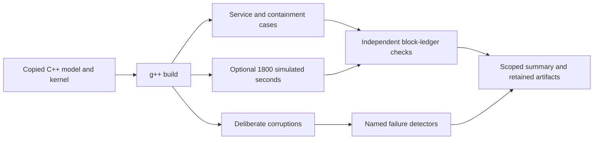

# Synthetic acquisition and processing stress model

## Purpose

This directory contains a native C++ event model for acquisition records, buffer ownership, host backpressure and a deterministic integer workload. It complements the [RTL CPU workload](../firmware/synthetic/README.md). Its 1,800-second case advances simulated time and uses an assumed firmware service time; it does not execute thirty minutes of CPU RTL or validate a physical recording system.

## Instructions

Use Python 3, a C++20-capable `g++`, zlib development files and the Linux `ldd` utility. Ubuntu supplies these through its Python, build-essential and zlib development packages. The wrapper locates `g++` on `PATH`, records its identity and links the model against zlib. Captured execution supports the Ubuntu/Linux environment; native Windows, WSL and macOS remain unverified, and the runtime-linkage recording explicitly uses Linux tooling.

A short campaign executes the normal service, containment and deliberately corrupted cases while omitting the 1,800-second case:

```sh
python3 microcontroller/synthetic/run_stress.py \
  --output /tmp/drg5-native-stress-short-new \
  --skip-endurance
```

Use a new output directory and omit `--skip-endurance` to request the full virtual-duration campaign. The runner rejects an existing output directory. It copies source inputs before compilation, retains build and case logs, records exact commands and hashes, and independently reconstructs the binary block ledger before compressing it.

Read `summary.json` and each case's result. Expected containment, a detected deliberate corruption and healthy uninterrupted service are distinct outcomes. A detector passes only when the corresponding ordinary checker emits its expected failure. The full model case accounts for 90 million frames over 1,800 simulated seconds; the declared 64,000-cycle firmware time is an input assumption rather than a measured CPU execution time.

[audit_synthetic.py](audit_synthetic.py) performs a broader evidence audit. It requires an explicitly selected model cohort, CPU cohort, guard simulation and synthesis records, provenance/contract records and replay reports. A `run_stress.py` output directory alone does not contain that complete bundle. The complete earlier campaign is not distributed here, so this audit must not be presented as a ready-to-run publication acceptance command. [test_audit_synthetic.py](test_audit_synthetic.py) calibrates that auditor using supplied evidence and deliberate record damage; it does not replace DUT verification.

## Implementation

| Source | Responsibility |
| --- | --- |
| [stress.cpp](stress.cpp) | Implements the event model, synthetic service schedule, record checks and fault scenarios. |
| [run_stress.py](run_stress.py) | Compiles immutable source copies, runs cases, checks the ledger and writes evidence. |
| [kernel.h](../firmware/synthetic/kernel.h) | Supplies the declared deterministic kernel shared with the compiled CPU workload. |
| [audit_synthetic.py](audit_synthetic.py) | Checks consistency and completeness across an explicitly supplied campaign. |
| [test_audit_synthetic.py](test_audit_synthetic.py) | Tests the auditor's rejection of missing, altered or contradictory evidence. |


