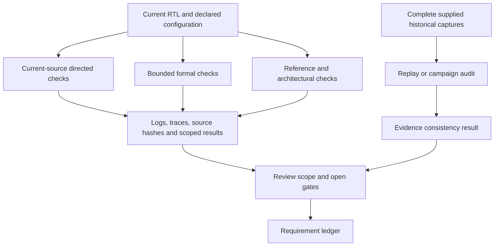

# Verification orchestration

## Purpose

This directory coordinates checks across the CPU, platform, reference model and evidence ledger. It distinguishes a new execution against current source from replay of an existing capture and from an audit of a complete campaign. The public source and selected captured records do not constitute a fully qualified CPU release.

## Instructions

Start with a focused [test runner](../tests/README.md), then expand to directed families or the [release acceptance planner](../release/README.md). Run commands from the repository root using the Ubuntu/Linux tool environment. Python orchestration alone does not install Verilator, Yosys, solvers, RISC-V GCC, Sail or ACT4. On Windows, enter [Ubuntu WSL2](../../docs/README.md#windows-powershell-and-wsl); on macOS, use an Ubuntu x86-64 VM or [remote Linux host](../../docs/README.md#linux-only-toolchains) for the commands below. These routes do not transfer the recorded results to a new installation.

[run_directed.py](run_directed.py) runs the existing directed checks against current source. It creates isolated source workspaces, retains each attempt and invokes the original checker with its original negative controls. Supply explicit tools and new build/evidence destinations:

```sh
python3 microcontroller/verification/run_directed.py \
  --verilator /tmp/drg5-control-tools-20260301/oss-cad-suite/bin/verilator \
  --yosys /tmp/drg5-control-tools-20260301/oss-cad-suite/bin/yosys \
  --build /tmp/drg5-directed-build-new \
  --evidence-dir /tmp/drg5-directed-evidence-new
```

Use `--help` to select particular families. This wrapper executes the selected directed suites; it does not run the separate full reference, architectural or formal campaigns. Read each attempt's command, source hashes, runner log and child summary before interpreting the aggregate status.

[run_verification.py](run_verification.py) is a campaign coordinator whose collection path requires earlier audit inputs, source-comparison records and evidence catalogs. It also updates [requirements.json](requirements.json) during selected campaigns. The publication does not contain all of those prior inputs. Consequently, neither its default run nor `--collect` is a turnkey publication verification command. The ledger retains scoped historical claims and references to absent records; a missing record remains an unverified claim in this copy.

The same dependency distinction applies to [audit.py](audit.py), [run_reuse_audit.py](run_reuse_audit.py) and [replay_archives.py](replay_archives.py). They inspect particular retained campaigns. A passing audit requires the complete campaign records and matching source identities.

## Implementation

| Entry point | Role and required inputs |
| --- | --- |
| [run_units.py](run_units.py) | Runs the existing standalone Makefile families with fixed tool paths and campaign outputs. |
| [run_directed.py](run_directed.py) | Executes selected directed runners against copied current RTL and test sources. |
| [formal/run_formal.py](formal/README.md) | Combines bounded controller and fetch checks with their witnesses and failure detectors. |
| [formal/run_admission_formal.py](formal/run_admission_formal.py) | Runs the separate early-admission/finite-service progress harness. |
| [execution/run_elf.py](execution/run_elf.py) | Loads a bounded ELF into the RTL execution platform and records the requested observations. |
| [execution/run_random.py](execution/run_random.py) | Builds generated programs and compares DUT retirement against Sail using the fixed compiler/reference installation. |
| [execution/comparison.py](execution/comparison.py) | Implements independent trace decoding/comparison used by reference runs and replay. |
| [act4/run_campaign.py](act4/README.md) | Coordinates pinned ACT4 generation, reference signatures, bounded DUT execution and inventory. |
| [requirements.json](requirements.json) | Associates requirements with scoped evidence and open gates; it is a ledger, not an executable checker. |



A comparison pass covers the modeled architectural events and memory contract. A bounded proof covers its stated assumptions and depth. A synthesis result covers the mapped configuration and tools. Hardware behavior, unsupported configurations and omitted test cases require their own evidence.
